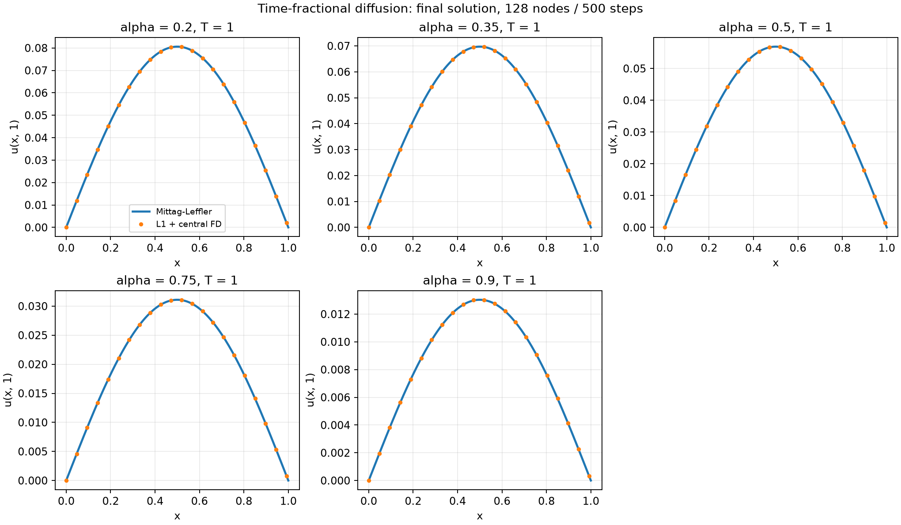
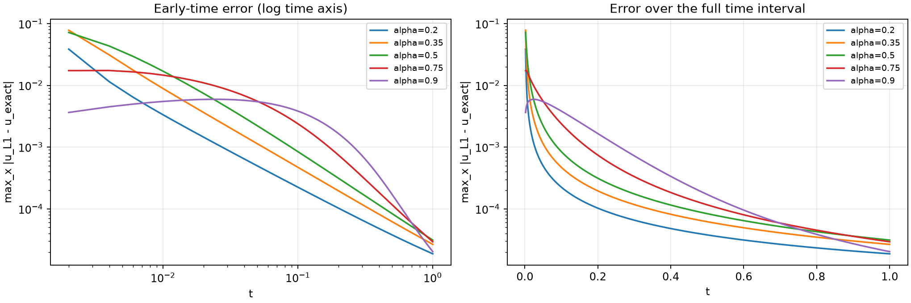
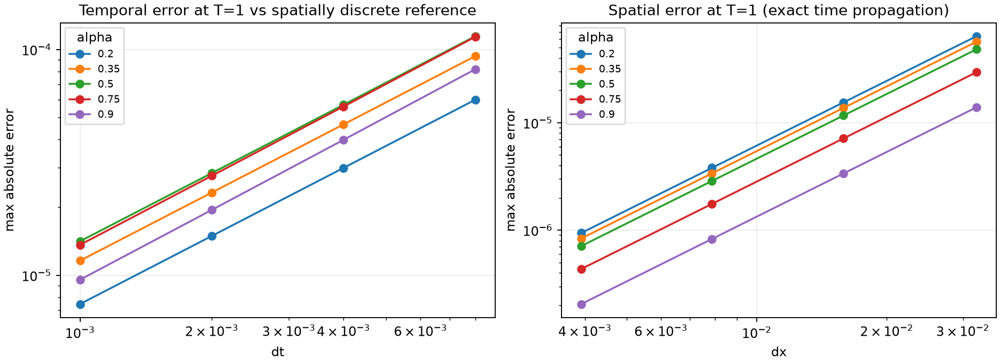
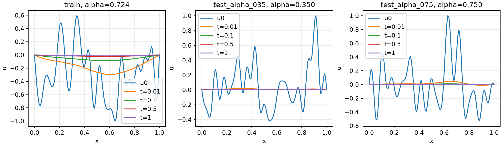
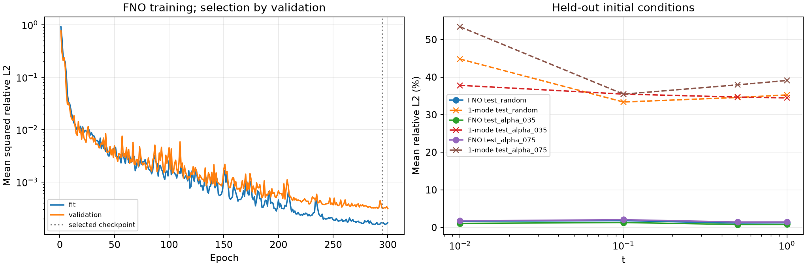
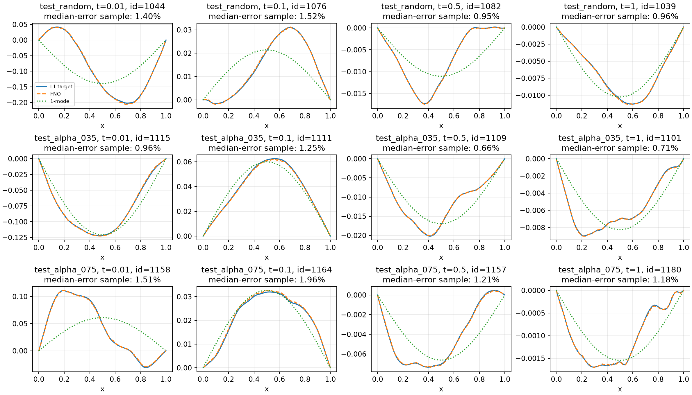
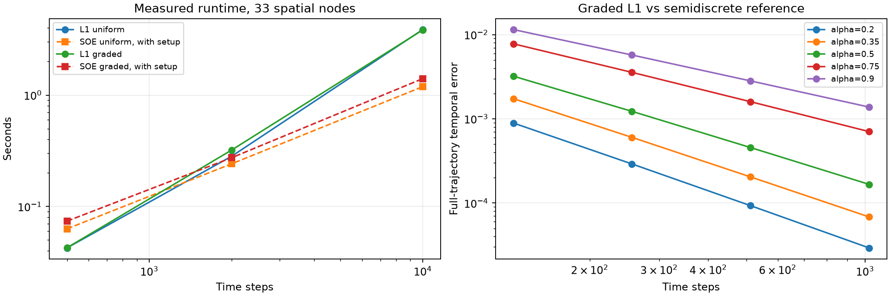

# Дробная диффузия по времени — Орлов

Учебный проект: решатель, проверка по функции Миттаг-Леффлера и датасет из **1000 обучающих + 200 тестовых примеров**.

## Постановка

$$
{}^C D_t^\alpha u(x,t)=u_{xx}(x,t),\qquad (x,t)\in(0,1)\times(0,1],
$$

$$
u(0,t)=u(1,t)=0,\qquad u(x,0)=u_0(x),\qquad 0.2\leq\alpha\leq0.9.
$$

Производная Капуто при $0<\alpha<1$:

$$
{}^C D_t^\alpha u(t)=\frac1{\Gamma(1-\alpha)}\int_0^t(t-s)^{-\alpha}u'(s)\,ds.
$$

Используются **128 пространственных узлов, включая обе границы**: $x_i=i/127$, $i=0,\dots,127$. Внутренних неизвестных — 126. Время: 500 равномерных шагов, $t_n=n/500$, включая 501 состояние с начальным.

## Численная схема

Пусть $b_j=(j+1)^{1-\alpha}-j^{1-\alpha}$, $\tau=1/500$, $h=1/127$. L1-аппроксимация:

$$
{}^C D_t^\alpha u^n\approx\frac{1}{\Gamma(2-\alpha)\tau^\alpha}
\sum_{j=0}^{n-1}b_j(u^{n-j}-u^{n-j-1}).
$$

Для $u_{xx}$ используются центральные разности при новом времени:

$$
\delta_{xx}u_i^n=(u_{i-1}^n-2u_i^n+u_{i+1}^n)/h^2.
$$

На каждом шаге решается система

$$
(I-c\delta_{xx})u^n=u^{n-1}-\sum_{j=1}^{n-1}b_j(u^{n-j}-u^{n-j-1}),\qquad c=\Gamma(2-\alpha)\tau^\alpha.
$$

В `src/solver.py` функция `solve_l1` решает трёхдиагональную систему с однократной факторизацией. Вся предыстория хранится без усечения. Расчёты и сохранённые массивы — `float64`.

Для массовой генерации используется `solve_l1_sine_batch`: тот же дискретный оператор диагонализуется в синусном базисе. Для моды k берётся **дискретное** собственное значение

$$
\lambda_{h,k}=4h^{-2}\sin^2(k\pi h/2).
$$

Время по-прежнему интегрируется L1-схемой с 500 шагами. Аналитическое решение непрерывного уравнения для получения меток не используется. Аргумент `sample_steps` сохраняет выбранные шаги в массив [batch, time, x]; без него возвращается прежнее конечное состояние. `solve_l1_batch` раскладывает произвольные сеточные начальные условия с нулевыми краями по всем внутренним модам через DST-I и использует тот же батч-решатель.

## Проверка точности

При $u_0=\sin(\pi x)$ точное решение:

$$
u(x,t)=E_{\alpha,1}(-\pi^2t^\alpha)\sin(\pi x).
$$

Эталон вычисляется пакетом `pymittagleffler`, при t=0 начальное значение задаётся точно. Дополнительно пакет проверен по тождеству $E_{1/2}(-z)=e^{z^2}\operatorname{erfc}(z)$, вычисленному через `scipy.special.erfcx`.

Фактически полученные результаты на сетке 128 × 500:

| α | max абсолютная ошибка при T=1 | Относительная L2 при T=1 | max ошибка по всем временам |
|---|---:|---:|---:|
| 0.20 | 1.8729e-05 | 0.02324% | 0.03858 |
| 0.35 | 2.6622e-05 | 0.03819% | 0.07800 |
| 0.50 | 3.1224e-05 | 0.05490% | 0.07180 |
| 0.75 | 2.9333e-05 | 0.09435% | 0.01738 |
| 0.90 | 2.0302e-05 | 0.15580% | 0.00594 |

Относительная L2-ошибка — отношение евклидовых норм численной ошибки и точного решения по пространству при T=1. Все максимумы по времени считаются **в узлах сетки**, а не между ними.

**Вблизи t=0 ошибка выше, чем при T=1.** Например, при α=0.35 на первом шаге t=0.002 абсолютная ошибка равна примерно 0.078. Для данной моды временная производная решения имеет особенность у нуля; высокая точность конечного состояния не означает такую же точность всей траектории. Равномерная сетка и L1-схема сохранены согласно заданию.





Сходимость при T=1 проверена для всех пяти α:

- Время: 125, 250, 500 и 1000 шагов при фиксированных 128 узлах. Чтобы отделить пространственную ошибку, эталон использует $E_{\alpha,1}(-\lambda_{h,1}t^\alpha)$. Ошибка монотонно уменьшается; наблюдаемое поведение близко к первому порядку.
- Пространство: 32, 64, 128 и 256 узлов. Сравниваются точное временное распространение пространственно дискретной системы и непрерывное решение. Пространственная ошибка уменьшается примерно как h². Это отдельная проверка пространственного оператора без ошибки L1 по времени.



Полные численные значения находятся в `results/validation_metrics.csv` и `results/convergence_metrics.csv`.

## Датасет

Файл: `data/dataset.npz`. 1000 обучающих и 200 тестовых начальных условий; загрузка без pickle.

Начальные условия — 32 синусные моды: коэффициенты независимы, распределены как Normal(0,1)/sqrt(k), затем делятся на максимум модуля начального условия на сетке. Seed: **20261016**. По сравнению с исходными восемью модами и спадом k^-1.5 это даёт больше высокочастотных составляющих.

Для каждого начального условия сохранены **t = 0.01, 0.1, 0.5, 1** из четырёх расчётов L1: для каждого конечного момента своя равномерная сетка из 500 шагов. Это даёт 500 шагов до t=0.01 вместо пяти и уменьшает раннюю временную ошибку. Вход сети включает u0, alpha и t. Четыре состояния одной траектории всегда принадлежат одной части выборки.

| Поле NPZ | Размер | Описание |
|---|---|---|
| `u0` | [1200, 128] | Начальные условия |
| `alpha` | [1200] | Порядки производной |
| `u` | [1200, 4, 128] | Состояния в сохранённые моменты |
| `t` | [4] | Моменты времени |
| `uT` | [1200, 128] | Последнее состояние, T=1 |
| `x` | [128] | Пространственная сетка |
| `split` | [1200] | Часть выборки |
| `coefficients` | [1200, 32] | Нормированные синусные коэффициенты |
| `output_mean`, `output_scale` | [4, 1] | Среднее и стандартное отклонение выхода по train для каждого t |
| `metadata` | scalar string | JSON с параметрами генерации |

| Индексы Python | split | Количество | alpha |
|---|---|---:|---|
| 0:1000 | `train` | 1000 | Равномерно из [0.2, 0.9) |
| 1000:1100 | `test_random` | 100 | Новые случайные из [0.2, 0.9) |
| 1100:1150 | `test_alpha_035` | 50 | 0.35 |
| 1150:1200 | `test_alpha_075` | 50 | 0.75 |

Фиксированные тестовые alpha отсутствуют в обучении. Это проверка интерполяции по alpha. Тестовые начальные условия независимы и имеют то же распределение; точных повторов среди 1200 входов нет.

```python
import numpy as np

with np.load('data/dataset.npz', allow_pickle=False) as data:
    train = data['split'] == 'train'
    u0_train = data['u0'][train]
    alpha_train = data['alpha'][train]
    times = data['t']
    normalized_train = (data['u'][train] - data['output_mean']) / data['output_scale']
    normalized_test = (data['u'][~train] - data['output_mean']) / data['output_scale']
    restored_test = normalized_test * data['output_scale'] + data['output_mean']
```

Среднее и масштаб оцениваются только на train и без пересчёта применяются к тестовым группам. Метрики FNO следует считать после обратного преобразования отдельно для каждой группы и каждого t. Нормировка по времени выравнивает общий масштаб разных t, но не устраняет зависимость амплитуды от alpha.

Аудит проверяет формы, конечность, границы, состав выборок, коэффициенты и нормировку. Девять контрольных траекторий во всех четырёх моментах сравниваются с общим трёхдиагональным решателем. Все 1200 траекторий сравниваются с аналитической суммой мод; результаты по каждому примеру и времени записываются в `results/full_dataset_accuracy.csv`. Доли энергии первой моды и ошибки по времени — в `results/dataset_report.json`.

| t | Энергия первой моды | Максимальная относительная L2-ошибка |
|---|---:|---:|
| 0.01 | 88.08% | 0.2555% |
| 0.1 | 97.02% | 0.2291% |
| 0.5 | 95.98% | 0.2656% |
| 1 | 95.81% | 0.2249% |

Максимальное расхождение девяти контрольных траекторий с трёхдиагональным решателем — 1.11e-14. Первая мода остаётся доминирующей: эти изменения обогащают данные, но сами по себе не доказывают сложность задачи для FNO.

Для каждого сохранённого момента выполнено 500 временных шагов. Погрешность зависит от времени и состава мод; значения приведены в таблице. Пространственная ошибка высоких мод больше, чем у первой моды. Эти метки являются решением указанной дискретной схемы, точность непрерывного решения нужно оценивать по отчёту. При T=1 диффузия по-прежнему подавляет высокие моды: богатство датасета оценивается по всем сохранённым временам.

Повторная генерация с тем же seed воспроизводит данные с точностью округления; между машинами следует ожидать расхождения порядка 1e-15, а не гарантировать побитовое совпадение. Отчёт содержит SHA256 конкретного NPZ и время генерации на текущей машине.



## Воспроизведение

Исходная версия проверена с Python 3.12.14; локальные правки проверены с Python 3.14.6, NumPy 2.5.4, SciPy 1.18.1, Matplotlib 3.11.2 и pymittagleffler 0.1.9. Из корня этой папки:

```bash
python3 -m venv .venv
source .venv/bin/activate
python -m pip install -r requirements.txt
python -m unittest discover -s tests -v
python -m src.validate
python -m src.generate_dataset
```

`requirements.txt` фиксирует версии основных библиотек, `requirements-lock.txt` содержит полный список версий окружения подготовки. `pymittagleffler==0.1.9` выбран после проверки: сборка 0.2.1 на процессоре машины подготовки завершалась с `Illegal instruction` при импорте.

Для запуска из Python:

```python
import numpy as np
from src.solver import solve_l1

x = np.linspace(0, 1, 128)
solution = solve_l1(np.sin(np.pi*x), alpha=0.5, n_steps=500)
print(solution.u.shape)  # (501, 128): время, пространство
```

`notebooks/demo.ipynb` содержит выполненные ячейки, таблицы и графики. Его можно просмотреть без повторного расчёта. Для перезапуска выбрать Python-окружение с установленными зависимостями и выполнить все ячейки; датасет загружается из готового файла, массовая генерация автоматически не запускается. Файлы графиков при повторном запуске перезаписываются.

Автоматические тесты дополнительно проверяют сохранение промежуточных состояний, полный DST, нормировку только по train, аудит данных при обычном и оптимизированном запуске и порядок сходимости на нестандартной сетке. Исходные восемь тестов проверяют независимую плотную сборку схемы на малой сетке, совпадение двух реализаций, известное тождество Миттаг-Леффлера, нулевое решение, линейность, начальное условие, веса L1 и обработку некорректных входов.

## Структура и ограничения

`src/` — численный код; `tests/` — проверки; `notebooks/` — демонстрация; `data/` — готовый небольшой датасет; `results/` — графики, таблицы и отчёты. Датасет намеренно включён в комплект, поскольку он небольшой. Окружение Python, кэши и временные файлы не включаются в Git.

Начальные условия датасета ограничены 32 синусными модами; экстраполяция по alpha и качество сети вне этого распределения не исследованы. Сравнение решателей и обучение FNO описаны ниже.

## FNO с alpha и временем на входе

`src/fno.py` реализует одномерную FNO: подъём четырёх каналов (u0, x, alpha, log10(t)), четыре блока спектральной свёртки через rFFT и локальной свёртки 1x1, GELU и проекция к решению. По умолчанию ширина 24, число сохраняемых частот 24; пространственное дополнение уменьшает влияние периодического продолжения. На краях физическое предсказание задаётся точно нулём. Входы должны быть конечными, 0 < alpha < 1 и t > 0; некорректные значения отклоняются с ValueError. При t=0 известно само начальное условие u0, этот момент сетью не вычисляется.

Из 1000 исходных train-траекторий **900** используются для подгонки весов, **100** — для выбора checkpoint. Все четыре времени одного начального условия остаются в одной части. Среднее и масштаб для обучения FNO пересчитываются только по этим 900 примерам: готовые статистики NPZ по всем 1000 здесь не используются. Ошибка обучения — средняя по примерам квадратичная относительная L2 в физических единицах, поэтому малые амплитуды не теряются за большими. Три тестовые группы оцениваются после завершения обучения и загрузки checkpoint с наименьшей validation loss.

Для сравнения обучается одномодовый базовый метод: коэффициент первой синусной моды начального условия умножается на полином пятой степени по alpha, отдельный для каждого времени. Его параметры тоже подгоняются только на 900 fitting-примерах по относительной ошибке. Аналитическая функция Миттаг-Леффлера и тестовые метки при обучении этого метода не используются.

Установка CPU-версии PyTorch и запуск:

```bash
python -m pip install torch==2.14.1 --index-url https://download.pytorch.org/whl/cpu
python -m pip install -r requirements.txt
python -m src.train_fno --epochs 300 --batch-size 64 --width 24 --modes 24 --depth 4 --lr 0.001 --threads 4 --device cpu --output results/fno
python -m src.plot_fno --output results/fno
```

Seed: 20261028. Используется AdamW, косинусное уменьшение шага и ограничение нормы градиента. Веса и статистики нормировки сохраняются в `results/fno/best.pt`; журнал — `history.csv`; разбиение, хеш датасета и все метрики — `metrics.json`; предсказания — `predictions.npz`. `requirements-lock.txt` фиксирует проверенное окружение Windows/Python 3.14 с CPU-сборкой PyTorch. Скорость и побитовая воспроизводимость между другими машинами не гарантируются.

Для каждой тестовой группы и каждого t отчёт содержит среднюю, медианную, 95-й процентиль и максимальную относительную L2, общую относительную L2 по группе и MAE. Компактная таблица сохраняется в `results/fno/test_metrics.csv`. Здесь проверяется интерполяция по alpha; качество на новых временах между четырьмя обучающими срезами и за пределами диапазона alpha не измеряется.

Результат одного запуска на CPU: 300 эпох, выбран checkpoint эпохи 295. Обучение и итоговая оценка заняли около 19.9 минуты. Ниже — **средняя по примерам относительная L2-ошибка в процентах**; это не максимум ошибки.

| Тестовая группа | t=0.01 | t=0.1 | t=0.5 | t=1 |
|---|---:|---:|---:|---:|
| test_random | 1.67% | 1.81% | 1.17% | 1.25% |
| test_alpha_035 | 1.09% | 1.31% | 0.79% | 0.80% |
| test_alpha_075 | 1.76% | 2.07% | 1.46% | 1.47% |

Одномодовый обучаемый метод в тех же группах и временах дал среднюю ошибку от 33.38% до 53.40%. В этом эксперименте FNO точнее его во всех 12 сравнениях. Эти результаты относятся к фиксированному датасету и seed; это не оценка всех возможных начальных условий.

Повторная загрузка весов проверена по сохранённым предсказаниям; разбиение fit/validation и SHA256 исходного датасета также проверены.





## Сгущённая сетка и SOE

`src/advanced_solver.py` добавляет два решателя с тем же пространственным оператором. `solve_graded_l1` использует неравномерную L1-формулу на сетке t_n=T(n/N)^r, по умолчанию r=(2-alpha)/alpha. При `grading=1` воспроизводится исходная равномерная L1. Пространственный оператор диагонализуется через полный DST-I; произвольные сеточные входы с нулевыми краями допустимы.

`solve_soe` считает последний временной интервал точно, а прошлую историю — рекуррентно через положительную сумму экспонент для ядра t^(-alpha)/Gamma(1-alpha). Экспоненты строятся логарифмической квадратурой представления Лапласа и уточняются до измеренного допуска. Это реализация прямой свёртки; она отличается от квадратуры ядра t^(-1-alpha) после интегрирования по частям в работе Jiang et al. Допуск проверяется на логарифмической выборке, а не строгой интервальной оценкой. Число экспонент зависит от alpha, минимального шага и допуска; в эксперименте оно составило 214–300.

```python
from src.advanced_solver import solve_graded_l1, solve_soe

solution = solve_graded_l1(u0, alpha=0.5, n_steps=500)
fast = solve_soe(u0, alpha=0.5, n_steps=10000, tolerance=1e-8)
```

Время выполнения и ошибки воспроизводятся командой `python -m src.benchmark_solvers --repeats 2`. Результаты: `results/solver_benchmark.json`, `results/solver_benchmark.csv`, `results/graded_convergence.csv`.

Для начального условия u0=sin(pi*x), alpha=0.5 и 33 пространственных узлов максимальная временная ошибка по всем узлам времени на 500 шагах равна **0.07176** для равномерной сетки и **0.0004719** для сгущённой. Эталон — точное распространение дискретного пространственного оператора через Миттаг-Леффлера, поэтому пространственная ошибка здесь исключена. Проверка сходимости охватывает все пять контрольных alpha и 128–1024 шага; наблюдаемые порядки ещё не во всех случаях достигли асимптотического 2-alpha.

| Сетка, 10 000 шагов | Полная L1 | SOE с подготовкой | Ускорение |
|---|---:|---:|---:|
| Равномерная | 3.880 с | 1.191 с | 3.26 раза |
| Сгущённая | 3.847 с | 1.406 с | 2.74 раза |

Это измерения на текущей машине, медиана двух запусков. При 500 шагах SOE медленнее L1. Максимальное расхождение SOE с полной L1 в этом сравнении — 1.59e-11. Память для истории SOE пропорциональна числу экспонент, но возвращаемый `Solution` всё равно содержит всю пространственно-временную траекторию. Оба новых решателя исследуются отдельно; готовый датасет по-прежнему получен исходной равномерной L1.



## Источники

- [pymittagleffler: исходный код и описание API](https://github.com/alexfikl/mittagleffler).
- [Jin, Lazarov, Zhou: An analysis of the L1 scheme for the subdiffusion equation with nonsmooth data](https://arxiv.org/abs/1501.00253) — анализ L1 и влияние временной регулярности решения.

- [Li et al.: Fourier Neural Operator for Parametric Partial Differential Equations](https://arxiv.org/abs/2010.08895).
- [Stynes, O’Riordan, Gracia: Error Analysis on Graded Meshes](https://doi.org/10.1137/16M1082329).
- [Jiang et al.: Fast evaluation of the Caputo fractional derivative](https://arxiv.org/abs/1511.03453).
